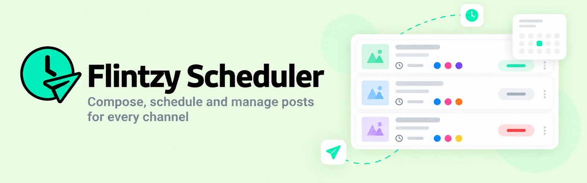

# Flintzy Post Scheduler



A social media post scheduler for Facebook, Instagram, X and TikTok, built for the Flintzy frontend assignment. Compose posts, schedule them, and manage the whole queue from one dashboard.

**Live demo:** _link added after deployment_

This is a frontend-only app. There is no login and nothing is published to a real network: all data and API calls are mocked in the browser.

## Features

| #   | Requirement                                                                     | How it works                                                                                                                                      |
| --- | ------------------------------------------------------------------------------- | ------------------------------------------------------------------------------------------------------------------------------------------------- |
| 1   | Queue grouped by day                                                            | Today, Tomorrow, then later dates; past days follow, most recent first. Each card shows a content preview, platform icons, local time and status. |
| 2   | Filter by platform and status, search by content, kept after refresh            | Stored in the URL, e.g. `?platform=x&status=failed&q=sale`. Invalid or repeated values are handled safely.                                        |
| 3   | Composer with text, multiple platforms, optional image URL and date-time picker | Opens in a dialog (full screen on mobile) with an image preview.                                                                                  |
| 4   | Live character counter per platform; over-limit blocks scheduling               | X 280, Instagram 2,200, TikTok 2,200, Facebook 5,000. Exactly at the limit is allowed.                                                            |
| 5   | Future times only, stored in UTC, shown in local time                           | The picker's local time is converted to a UTC ISO string; the queue shows times in the viewer's time zone.                                        |
| 6   | Retry failed posts with an optimistic update                                    | The card updates instantly; the mock request takes 1 second, fails 20% of the time, and rolls back with an error message.                         |
| 7   | Loading, empty and error states; responsive                                     | Skeleton loader, empty and no-results states, error state with "Try again". Tested at phone and desktop widths.                                   |

## Getting started

Requires **Node.js 22.12 or newer**.

```bash
npm install
npm run dev        # http://localhost:5173
```

| Script                  | What it does                      |
| ----------------------- | --------------------------------- |
| `npm run dev`           | Start the dev server              |
| `npm run build`         | Type-check and build to `dist/`   |
| `npm run preview`       | Serve the production build        |
| `npm test`              | Run all tests once                |
| `npm run test:watch`    | Run tests in watch mode           |
| `npm run test:coverage` | Tests with a coverage report      |
| `npm run typecheck`     | TypeScript only                   |
| `npm run lint`          | Lint with oxlint (incl. jsx-a11y) |
| `npm run format`        | Format with Prettier              |

## Offline and installable

The app is a Progressive Web App. A service worker precaches the app shell and caches fonts and post images as they load, so after the first visit it opens and works fully offline. The mock API runs in the browser, so you can still filter, schedule and retry posts with no connection. A banner appears while you're offline. In Chrome or Edge, use **Install** in the address bar to add it as an app; on iPhone, **Share → Add to Home Screen**.

## Social sharing

Shared links show a title, description and preview image on WhatsApp, LinkedIn, Facebook, Slack and X (Open Graph and Twitter Card tags in `index.html`). Most platforms require absolute image URLs, so the build fills in the site URL: on Vercel it is detected automatically from `VERCEL_PROJECT_PRODUCTION_URL`, and elsewhere you can set `VITE_SITE_URL=https://your-domain` before `npm run build`.

## Trying the harder cases

- **Offline:** load the app once, then turn off your connection (or use DevTools → Network → Offline) and reload.
- **Error state:** open the app with `?simulate=load-error`. The first load fails; "Try again" recovers.
- **Retry:** filter by **Failed** and press **Retry**. Each attempt fails 20% of the time, so try a few posts to see both the success and the rollback.
- **Character limits:** select X and Facebook, then paste more than 280 characters. The X counter turns red and scheduling is blocked, while Facebook stays within its limit.
- **Filters after refresh:** pick some filters, search, then reload the page.

## Project structure

```
src/
├── api/            Mock API: getPosts, createPost, retryPost
├── app/            App shell and providers (router, query client, toasts)
├── components/     Shared UI: Modal, StatePanel, toasts, PlatformIcon
├── features/
│   ├── posts/      Queue, post card, status badge, retry
│   ├── filters/    Filter bar, URL parsing, filtering
│   └── composer/   Composer form, character counters, validation, create
├── lib/            Pure helpers: dates, character counting, platform limits, URLs
├── mocks/          Seed data (32 posts) and its loader
└── types/          Post, Platform, PostStatus
```

Business rules live in plain functions (`lib/`, `filterParams.ts`, `composerValues.ts`) so they are tested without rendering. Components stay thin.

## Key decisions

- **Vite + React 19 + TypeScript (strict).** A fully mocked app needs no server rendering, and Vite keeps the build and deploy simple.
- **Mock API as an in-memory module instead of MSW.** The brief allows a local JSON file. `api/postsApi.ts` returns Promises with simulated delays, and its randomness and delays can be injected, so the 20% failure rate is tested deterministically. MSW would add a service worker in production for no extra benefit here.
- **Seed dates stay current.** `posts.json` stores real UTC timestamps relative to a fixed `generatedAt`. On load every timestamp is shifted by the time elapsed since then, so Today and Tomorrow always have posts and past/future statuses stay consistent whenever the app is opened.
- **TanStack Query for server state.** It handles loading and error states, refreshes the queue after creating a post, and supports the optimistic retry with rollback.
- **Optimistic retry that's safe to run concurrently.** Retry immediately marks the post published. Failure restores only that post, never a snapshot of the whole list, and the list is not refetched afterwards, so retries on several posts can run at once without overwriting each other. Duplicate requests for the same post are blocked.
- **Filters live in the URL.** The URL is the single source of truth. Updates replace the history entry instead of adding one, and search is debounced by 300 ms.
- **Local time → UTC without surprises.** The `datetime-local` value is parsed from its parts as local time, never via `new Date(string)`. Impossible dates (e.g. 30 Feb) and times skipped by a daylight-saving change are rejected instead of silently rolling over.
- **Character counting by graphemes.** `Intl.Segmenter` counts what a person sees as one character, so 👍🏽 and 👨‍👩‍👧 count as 1. `string.length` would count 4 and 8.
- **One design system.** Colours, the type scale (Titillium Web for headings, Inter for body), radii, shadows and the button, chip, card and input styles are Tailwind v4 theme tokens and utilities in `styles/index.css`. Components use only those tokens.
- **Native `<dialog>` for the composer.** `showModal()` provides the focus trap, Escape to close, an inert background and focus return without custom code.
- **Accessibility.** Native semantics first (`fieldset`/`legend`, `<output>` for status text, `<time>`), labelled controls, toggle chips with `aria-pressed`, errors linked to fields with `aria-describedby`, a skip link, visible focus rings and WCAG AA colour contrast, partly enforced by oxlint's jsx-a11y rules. Keyboard navigation was checked in Chrome.

## Assumptions

- Within one filter, values match any of them (X **or** Facebook). Platform, status and search must all match together. A post matches a platform filter if it includes any selected platform.
- Search is a case-insensitive substring match on the content.
- A successful retry sets the post to **published**. This is simulated; nothing is sent to any social network.
- New posts are created as **scheduled**. The image URL is optional, but if given it must start with `http://` or `https://`. Whether the image actually loads is not validated; broken images are hidden.
- Data is held in memory, so new posts and retries reset on page reload.
- Character counts follow the brief's limits literally. Real platforms differ slightly (X counts links as 23 characters, for example).

## Testing

157 tests with Vitest and Testing Library. Statement coverage is about 99%.

- Unit tests for date grouping and UTC conversion, character counting, validation, URL filter parsing and the mock API.
- Component and integration tests for the queue, filters, composer and retry, including rollback and concurrent retries.
- An end-to-end journey against the real mock API: filter failed posts, retry one, schedule a post for tomorrow, find it by search.

GitHub Actions runs type-checking, lint, formatting, tests and the build on every push to `main` (see `.github/workflows/ci.yml`).

Tests run with the time zone fixed to `Asia/Kolkata` (UTC+5:30), so any accidental UTC/local mix-up fails visibly. The suite also passes with the system clock set to UTC and to America/Los_Angeles.

## Known limitations

- Data is not persisted between reloads.
- Day labels (Today/Tomorrow) refresh on the next data load, not exactly at midnight.
- Toasts do not pause while hovered.
